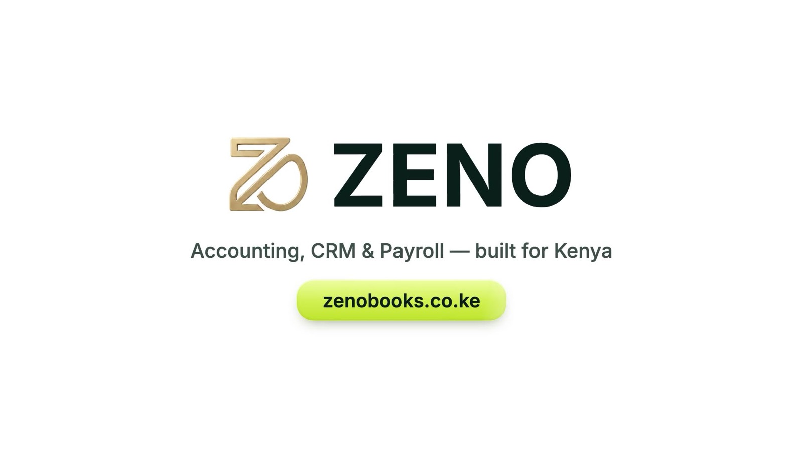
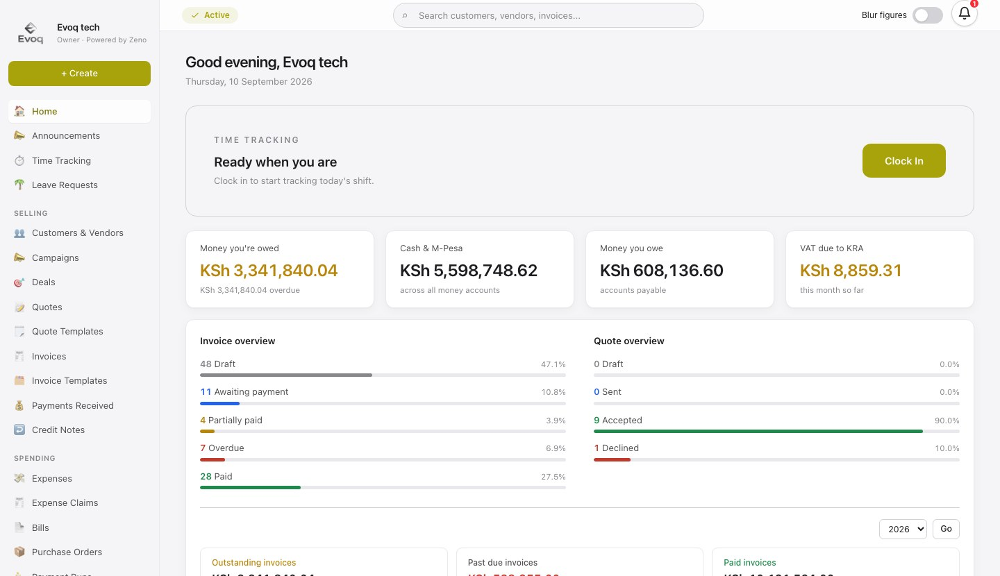
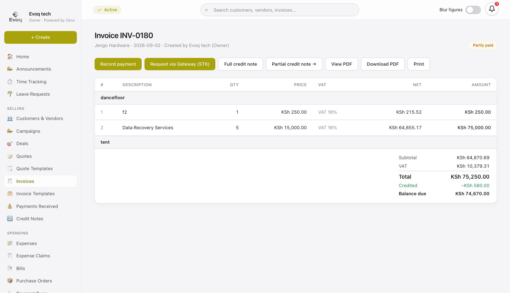
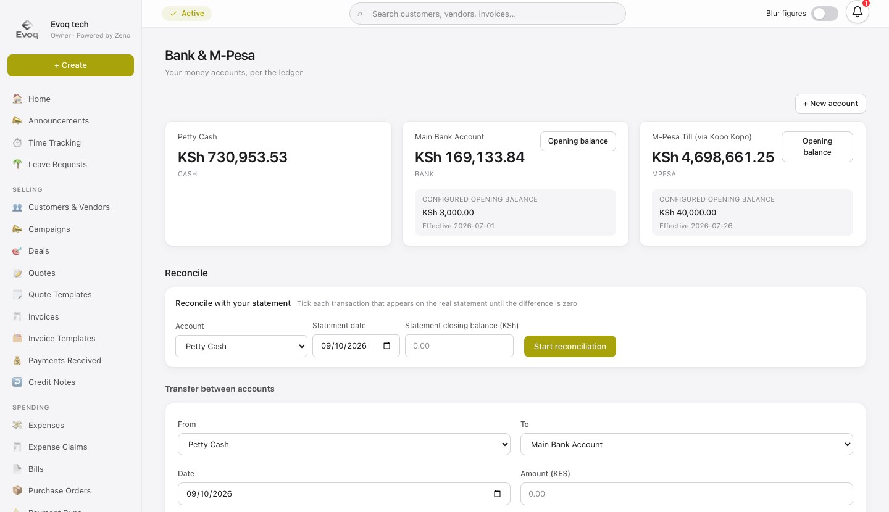
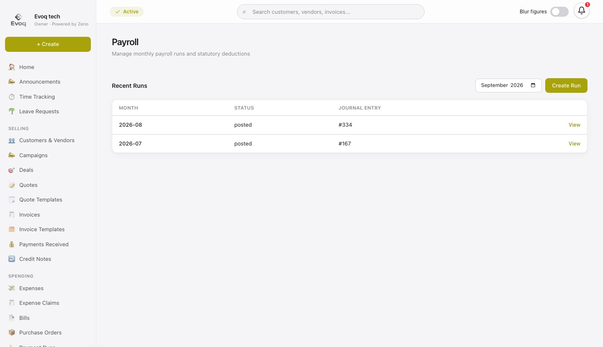
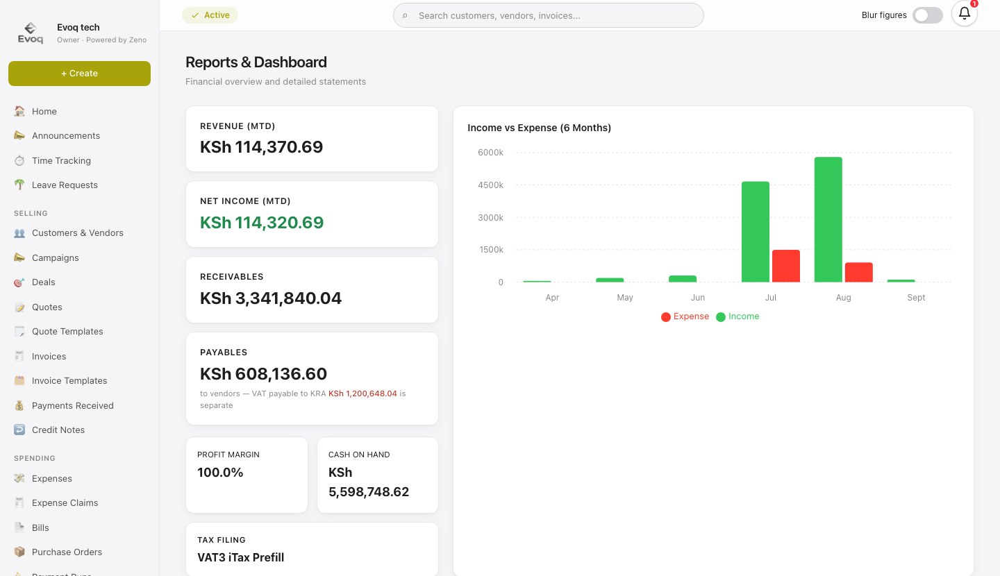
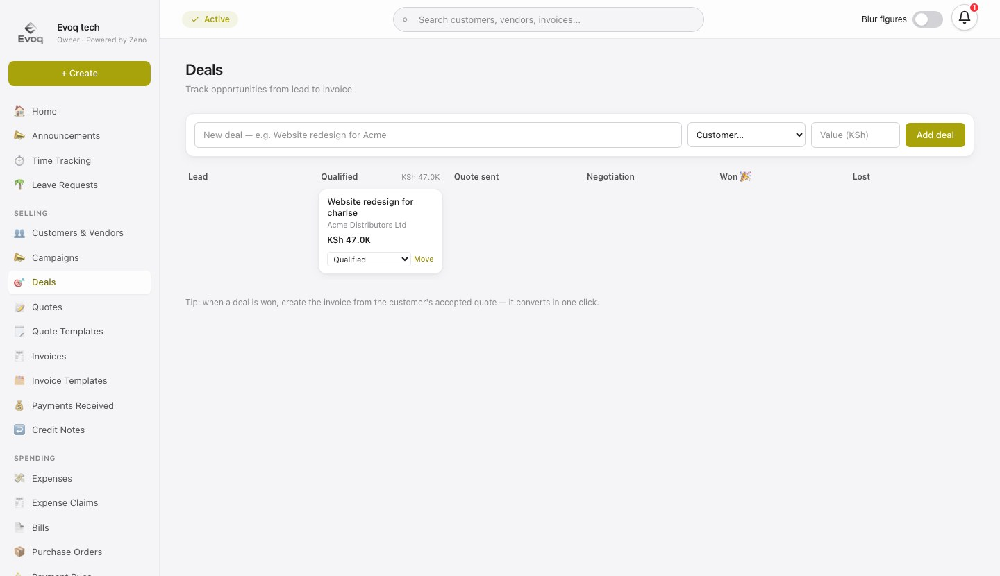
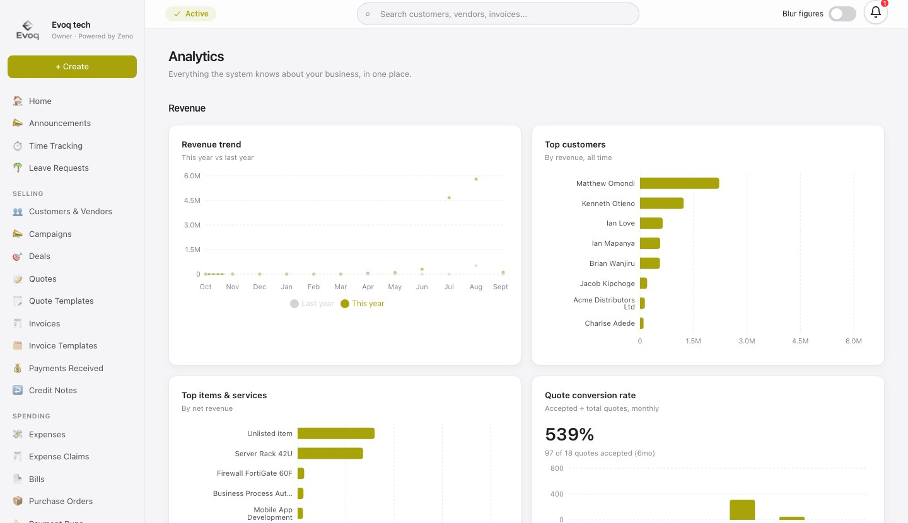
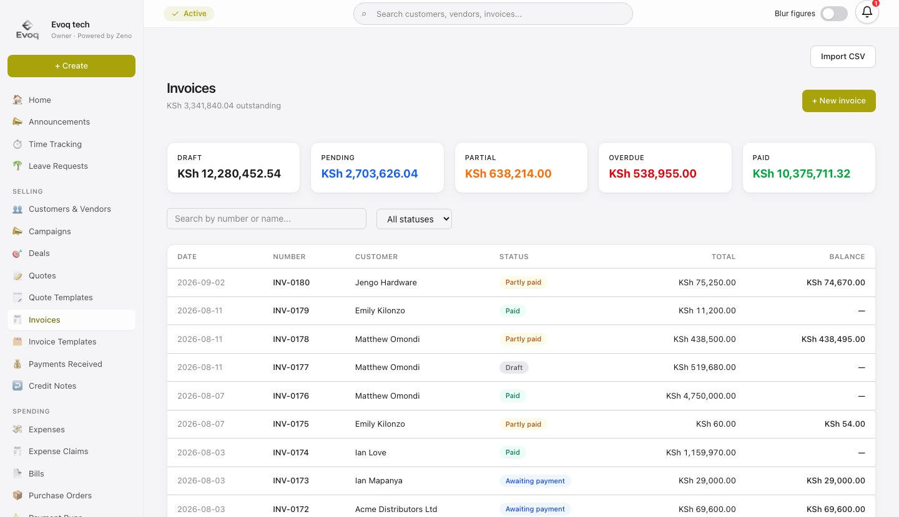

<p align="center">
  
</p>

<p align="center">
  <b>Accounting, CRM and payroll for Kenyan businesses — invoices you get paid for on M-Pesa, books that reconcile themselves, and payroll with PAYE, NSSF, SHIF and Housing Levy done for you.</b>
</p>

<p align="center">
  <a href="https://www.zenobooks.co.ke">zenobooks.co.ke</a> ·
  <a href="#features">Features</a> ·
  <a href="#getting-started">Getting started</a> ·
  <a href="#architecture">Architecture</a>
</p>

<p align="center">
  
  
  
  
  
</p>

---

## Why Zeno

Most Kenyan SMEs run their money across a global accounting tool, a separate payroll product and a spreadsheet for matching M-Pesa. Zeno is one system for all of it, built around how business actually works here:

- **Get paid on M-Pesa.** Send an STK push from the invoice; the payment lands, matches itself to the invoice and marks it paid.
- **Books that reconcile.** Every document posts to one double-entry ledger, so reports always tie out.
- **Kenyan payroll built in.** PAYE, NSSF, SHIF and the Affordable Housing Levy calculated from dated statutory rules, with payslips.
- **KRA-ready.** 16% / zero-rated / exempt VAT on every line, VAT3 figures, withholding VAT handled on receipt.

<p align="center">
  
  <br><sub>Home — what you're owed, cash across bank and M-Pesa, what you owe, VAT due.</sub>
</p>

## Features

<table>
  <tr>
    <td width="50%" valign="top">
      
      <h4>Sales — quotes to cash</h4>
      Quotes, invoices and credit notes with category headings, line and whole-document discounts, and other display currencies (USD, EUR, GBP) while the books stay in KES. Merge quotes, convert to invoices in one click, collect by M-Pesa STK push, and send customers a self-service portal.
    </td>
    <td width="50%" valign="top">
      
      <h4>Bank &amp; M-Pesa</h4>
      Money accounts for banks, M-Pesa tills and cash. Import bank CSVs and password-protected Safaricom M-Pesa PDF statements, auto-categorise with rules, and reconcile line by line.
    </td>
  </tr>
  <tr>
    <td width="50%" valign="top">
      
      <h4>Payroll</h4>
      Monthly runs with statutory deductions, days-worked pro-rating, staff loans and salary advances, employer costs, payslip PDFs, and a two-step post-then-pay flow that records which account the salaries left from.
    </td>
    <td width="50%" valign="top">
      
      <h4>Reports</h4>
      P&amp;L, balance sheet, trial balance, cash flow, general ledger, aging, debtors, VAT and VAT3, withholding tax — every figure read from the ledger, exportable to CSV and PDF.
    </td>
  </tr>
  <tr>
    <td width="50%" valign="top">
      
      <h4>CRM</h4>
      Customers and vendors with KRA PINs and statements, a deals pipeline, customer groups, and SMS campaigns.
    </td>
    <td width="50%" valign="top">
      
      <h4>Analytics &amp; the Zeno assistant</h4>
      Revenue trends, top customers and items, quote conversion — plus an AI assistant that answers questions about your books and asks before changing anything.
    </td>
  </tr>
</table>

**Also in the box:** purchase orders with partial billing, bills with approvals and payment runs, expenses and expense claims, FIFO inventory across warehouses with bills of materials, fixed assets with depreciation, business loans with interest schedules, recurring invoices, budgets, cost centres, period locks, roles and permissions per module, an audit log, and per-organisation backups with restore.

<p align="center">
  
  <br><sub>Invoices — draft, pending, partly paid, overdue and paid at a glance.</sub>
</p>

## Getting started

**Requirements:** Node.js 20+, a Supabase project (Postgres, Auth, Storage, Realtime).

```bash
git clone https://github.com/Asta39/zeno.git
cd zeno
npm install
```

Create `.env.local`:

```bash
DATABASE_URL=postgresql://postgres.<project-ref>:<password>@aws-0-<region>.pooler.supabase.com:6543/postgres
NEXT_PUBLIC_SUPABASE_URL=https://<project-ref>.supabase.co
NEXT_PUBLIC_SUPABASE_ANON_KEY=<anon key>
SUPABASE_SERVICE_ROLE_KEY=<service role key>   # staff invites, backups
JWT_SECRET=<long random string>                # customer portal sessions
CRON_SECRET=<long random string>               # scheduled jobs
SUPER_ADMIN_EMAILS=you@example.com
```

Then:

```bash
npm run db:push   # applies src/db/migration.sql (idempotent)
npm run db:seed   # Kenyan chart of accounts + starter data
npm run dev       # http://localhost:3000
npm test          # unit + integration tests
```

## Architecture

**The ledger is the hub.** Invoices, bills, expenses, payments, payroll and loans are friendly editors over one append-only double-entry ledger. Reports never add up document totals — they read the ledger, so they always reconcile.

| Path | Responsibility |
|---|---|
| `src/lib/posting.ts` | The only writer to the ledger — posting rules per document type; voids post reversals |
| `src/lib/tax.ts` | Pure Kenyan VAT engine — 16% / 0% / exempt, inclusive or exclusive, per-line rounding, document discounts |
| `src/lib/inventory.ts` | FIFO cost lots, warehouse moves, bill-of-materials consumption |
| `src/lib/payroll.ts` | Statutory payroll engine driven by dated rules |
| `src/lib/payments/` | M-Pesa Daraja and Kopo Kopo gateways, verified webhooks, auto-matching |
| `src/lib/reports.ts` | P&L, balance sheet, VAT return, aging, ledger queries |
| `src/lib/org-backup.ts` · `org-restore.ts` | Nightly per-org snapshots and in-place, transactional restore |

**Stack:** Next.js 15 (App Router, Server Actions) · TypeScript · Drizzle ORM on Supabase Postgres · Supabase Auth, Storage and Realtime · Tailwind CSS 4 · React PDF · deployed on Vercel (Frankfurt, next to the database).

**Conventions:** money is integer cents everywhere; every query is scoped to the signed-in organisation; module access is enforced per role.

## Project notes

- KRA eTIMS signing ships behind a feature flag with a simulated control unit; a certified OSCU/VSCU integration is required before fiscal use.
- Design references, research and specs live in [`docs/`](docs).

---

<p align="center"><sub>© Zeno · Accounting, CRM &amp; Payroll for Kenyan businesses</sub></p>
